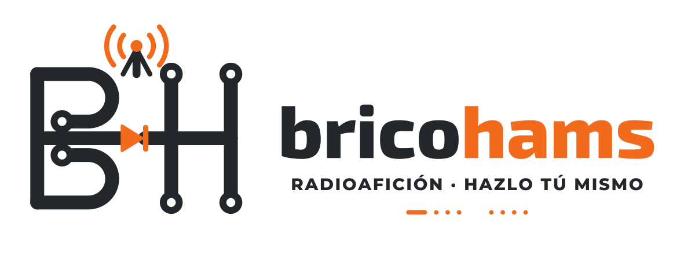

<div align="center">
  

  # BRICOHAMS QUANSHENG STUDIO

  **Radioafición · Hazlo tú mismo**

  Gestor de canales, configuración y firmware para **Quansheng UV-K1 / UV-K5 V3** con **F4HWN Fusion 6.0 / 6.1**, desarrollado como una aplicación web en español.
</div>

> [!WARNING]
> **Proyecto experimental, no oficial.** La conexión y la escritura USB, la programación Multiboot y el flasheo principal pueden fallar o dejar el equipo sin arrancar. Este HTML no se ha validado de forma exhaustiva con radios físicas. Antes de escribir, conserva una copia completa hecha con una herramienta probada, como CHIRP, y asegúrate de que el firmware y el modelo son compatibles.

## ✨ Funciones

| Sección | Funcionalidad |
| --- | --- |
| **Conexión** | Acceso por USB desde el navegador, detección de F4HWN Fusion 6.0 / 6.1 y lectura automática de canales. |
| **Canales** | Hasta 1.024 memorias, edición directa en la tabla, RX/TX, simplex o repetidor, tonos, potencia, escaneo y modos FM, NFM, AM, NAM y USB. Catálogo de repetidores de España agrupado por distritos EA1–EA9: cada distrito va a su lista de escaneo y el nombre en pantalla puede ser el indicativo, la localidad o ambos. |
| **Configuración** | Edición de los ajustes compatibles con el firmware: pantalla, teclas, squelch global, escaneo, DTMF, radio FM y más. |
| **Archivos y copias** | Importación/exportación CSV (incluidos CHIRP y formatos similares), copias de memoria BIN, exportación de calibración y copia/importación de los textos del logo de arranque. |
| **Flash** | Consulta y grabación de slots de usuario **1–4** de Multiboot, y programación del firmware principal en modo FLASH/DFU. |
| **Modo PRO** | Reduce confirmaciones y evita la descarga obligatoria de BIN para operaciones habituales de canales y configuración. Las confirmaciones de Flash siguen activas. |

La aplicación también incorpora una lista de ejemplo de **42 canales de Murcia, PMR y satélites**. Revisa las frecuencias, permisos de transmisión y configuración antes de grabarlas.

## 💻 Requisitos

- Un **Quansheng UV-K1 o UV-K5 V3** compatible con F4HWN Fusion 6.0 o 6.1, según la operación.
- Cable USB de programación adecuado para la radio y sus controladores instalados en el ordenador.
- **Google Chrome o Microsoft Edge** con soporte para la API Web Serial.
- Para utilizarlo sin Internet, solo se necesita el archivo `index.html`. El logo y los dos firmware de la pestaña **Flash** van integrados en el HTML.
- Cualquier otro firmware `.bin` debe conseguirse por separado, de fuentes fiables y compatibles con el modelo.

## 📦 Formas de usarlo

| Forma | Cómo | Plataformas |
| --- | --- | --- |
| **Web** | Abre <https://brico-hams.github.io/Bricohams-Studio/> en Chrome o Edge. | Cualquier sistema con Web Serial |
| **Archivo suelto** | Descarga `index.html` y ábrelo con doble clic. Funciona sin Internet. | Cualquier sistema con Web Serial |
| **Instalado** | Instala [Bricohams Radio Workspace](https://github.com/Brico-Hams/Radio-Web-install/releases/latest) y verifica antes el archivo con su `SHA256SUMS`. Studio va incluido y se abre en `http://127.0.0.1:8787/studio.html`. | Windows 11 x64, Debian/Ubuntu, Raspberry Pi OS (arm64/armhf), Arch Linux, FreeBSD 14 |

La versión instalada sirve una copia de este `index.html` fijada por commit y SHA-256 (`studio.lock.json` en Radio Workspace). Por eso puede ir unas versiones por detrás de la web. Allí, además, se pueden preparar canales con corrección Doppler para pases de satélites FM.

## 🚀 Inicio rápido

1. Abre la web o descarga `index.html` y ábrelo con **Chrome o Edge**.
2. Enciende la radio normalmente y conéctala mediante su cable de programación.
3. En **Conexión**, pulsa **Conectar, detectar y leer** y concede acceso al puerto serie.
4. Abre **Canales** para ver las memorias leídas. Puedes pulsar directamente las celdas para editar.
5. Para modificar ajustes generales, entra en **Configuración**.
6. **Guarda una copia de seguridad verificable antes de cualquier escritura**. Cuando corresponda, pulsa **Subir canales** o **Guardar ajustes en la radio**.
7. Tras la escritura de canales, la aplicación intenta reconectarse y volver a leer la radio.

**Modo PRO:** está pensado para personas que conocen el riesgo de escribir sin descargar un respaldo en cada operación. Desactivarlo no elimina la necesidad de tener un respaldo recuperable.

## ⚡ Flash: Multiboot y firmware principal

La pestaña **Flash** ofrece dos firmware integrados en `index.html` y la opción de elegir otro archivo:

| Opción | Archivo integrado | Tamaño | SHA-256 |
| --- | --- | --- | --- |
| **STABLE** (F4HWN Fusion 6.1.0) | `stable.bin` | 107.644 B | `4458bd5e55461394b5c91efa768e5f8ba676204c776875c1391c97346188fe70` |
| **ARDF** (F4HWN 6.0.0) | `ardf.bin` | 114.360 B | `c257b7da3e57b1c0331a01cbae163a0552310c3439f48d5e55457f74eec87f0e` |
| **Otro BIN** | Elegido por ti | — | — |

`stable.bin` es idéntico a `f4hwn.fusion.v6.1.0.bin` de la [release v6.1.0 de F4HWN](https://github.com/armel/uv-k1-k5v3-firmware-custom/releases/tag/v6.1.0). El hash de `ardf.bin` no coincide con ningún archivo publicado por F4HWN ni por [reald/ARDF](https://github.com/reald/uv-k1-k5v3-firmware-custom/releases): su procedencia está **pendiente de documentar**.

Al abrir la página, la aplicación comprueba el tamaño y el CRC32 de cada BIN integrado antes de ofrecerlo. No necesita acceder a carpetas ni a la red.

### Slots Multiboot (1–4)

Con la radio encendida en modo normal y el Multiboot compatible instalado, utiliza **Leer slots del walkie**, selecciona el slot y el BIN y confirma la operación. El slot **M (Main)** no se presenta como slot de usuario editable.

### Firmware principal (modo FLASH/DFU)

Apaga la radio. Después, mantén pulsado **PTT** al encenderla para entrar en modo de actualización, conéctala desde **Flash** y selecciona el firmware principal apropiado. **No utilices aquí un BIN que no esté destinado explícitamente al firmware principal de tu modelo.** Sigue las indicaciones del firmware y evita cualquier interrupción de alimentación.

**Encontrar un archivo `.bin` o poder seleccionarlo no garantiza compatibilidad.** El flasheo está implementado de manera experimental y su uso puede necesitar recuperación manual del dispositivo.

## 📻 Notas de configuración

- **ChDisp → NAME**: muestra el nombre de memoria en lugar de la frecuencia cuando el walkie está en modo memoria (MR).
- **Misma TX**: transmisión y recepción en la misma frecuencia. **TX bloqueada** es una situación distinta y se respeta cuando está almacenada así.
- Los modos seleccionables por canal incluyen **FM, NFM, AM, NAM y USB**. No se presenta LSB como opción soportada por los controladores revisados.
- El **squelch de ruido es global**: los tonos de recepción por canal no equivalen a desactivar el squelch.
- La **calibración** puede exportarse para respaldo, pero **no** se ofrece edición ni restauración de calibración desde esta herramienta.
- Las copias BIN completas generadas por la aplicación **no disponen de restauración BIN automática** en esta versión.

## 🔒 Seguridad y buenas prácticas

- Guarda siempre una copia de seguridad recuperable **de tu propia radio** antes de grabar.
- No compartas públicamente copias de calibración, imágenes BIN de tu emisora, identificadores, códigos DTMF ni configuraciones privadas.
- Comprueba que el modelo, la versión F4HWN, el slot y el BIN son los correctos antes de flashear.
- No desconectes el cable ni apagues la radio durante una escritura o flasheo.
- El respeto de las normas de uso del espectro y de las condiciones de transmisión corresponde a quien utiliza el equipo.

## 🧩 Estructura del repositorio

```text
.
├── index.html                 # Aplicación web autónoma
├── README.md                  # Documentación del proyecto
└── assets/
    └── logo-bricohams.png    # Imagen para este README
```

## 📚 Agradecimientos y proyectos relacionados

- [F4HWN — Firmware personalizado UV-K1 / UV-K5 V3](https://github.com/armel/uv-k1-k5v3-firmware-custom).
- [UV Studio](https://armel.github.io/uvstudio/), como referencia funcional del apartado Flash.
- [CHIRP](https://chirpmyradio.com/), y los controladores F4HWN de Fusion 6.0 y 6.1 utilizados como referencia de formatos y comandos.

**BRICOHAMS QUANSHENG STUDIO es un proyecto independiente; no es una herramienta oficial de Quansheng ni de F4HWN.** Se deben conservar los créditos y respetar las licencias de cualquier código o recurso de terceros incorporado o adaptado.

## 📄 Licencia y publicación

**Antes de publicar o distribuir el código**, revisa las condiciones de las dependencias y del código de origen: los controladores CHIRP facilitados con este proyecto incluyen avisos **GNU GPL versión 2 o posterior**. Si el HTML contiene código derivado sujeto a GPL, debe respetarse esa licencia al redistribuirlo. Añade el archivo `LICENSE` y los avisos legales adecuados tras comprobar todas las procedencias.

`index.html` **incluye** los firmware `stable.bin` y `ardf.bin` (ver [Flash](#-flash-multiboot-y-firmware-principal)). Al redistribuirlo se distribuyen también esos binarios: respeta la licencia de F4HWN (Apache-2.0), conserva sus créditos y documenta la procedencia de `ardf.bin` antes de publicar nuevas versiones.
